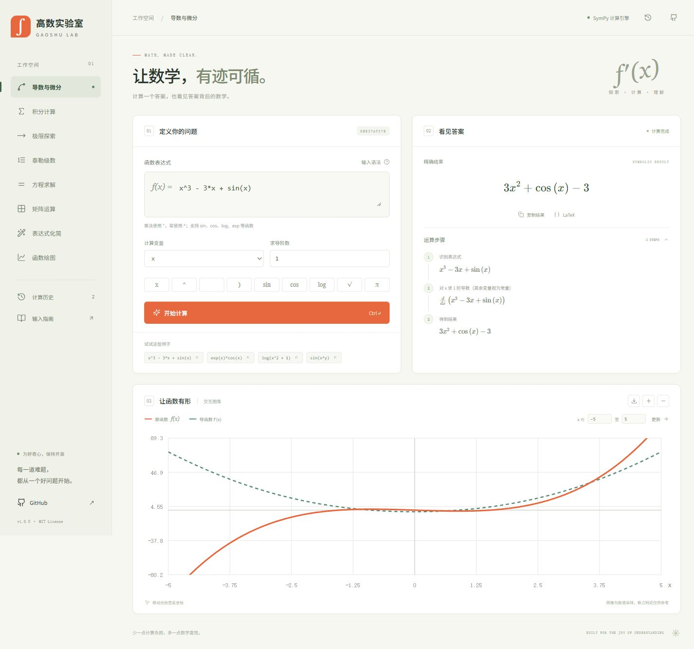

# ∫ 高数实验室 · Gaoshu Lab

**让数学，有迹可循。** 一个免费、开源的中文高等数学计算工作台。用 SymPy 做真实符号计算，用交互函数图像理解结果。




## 功能

| 工具 | 能力 | 示例 |
| --- | --- | --- |
| 导数与微分 | 1–8 阶导数、多元表达式偏导 | `sin(x*y)` 对 `y` 求导 |
| 积分 | 不定积分、定积分、反常积分 | `sin(x)` 从 `0` 到 `pi` |
| 极限 | 双侧、左侧、右侧与无穷远极限 | `sin(x)/x`，`x → 0` |
| 泰勒级数 | 指定展开点与 1–12 阶截断 | `exp(x)` 在 `0` 处展开 |
| 方程 | 实数域符号解集 | `x^3-6*x^2+11*x-6 = 0` |
| 矩阵 | 行列式、逆矩阵、行最简形、秩（最多 5×5） | `1,2;3,4` |
| 化简 | 精确符号化简 | `sin(x)^2+cos(x)^2` |
| 绘图 | 实数曲线、导函数/级数叠加、悬停坐标、缩放、SVG 导出 | `exp(-x^2)` |

还有：KaTeX 公式排版、运算与中间结果展示、结果/LaTeX 复制、例题、数学键盘、`Ctrl/⌘ + Enter` 快捷计算、30 条本地历史和手机布局。

## 快速启动

需要 Python 3.10+、Node.js 22.12+。本项目不需要 API Key、AI 服务或数据库。

```bash
git clone https://github.com/qingmengyide/gaoshu-lab.git
cd gaoshu-lab
python -m venv .venv
```

激活虚拟环境：

```bash
# macOS / Linux
source .venv/bin/activate
# Windows PowerShell（两者任选其一）
.venv\Scripts\Activate.ps1
```

安装、构建并启动：

```bash
pip install -r requirements.txt
npm ci
npm run build
python server.py
```

浏览器打开 **http://127.0.0.1:8000**。Windows 若不能运行激活脚本，可直接用 `.venv\Scripts\python.exe` 替代上面的 `python`，用 `.venv\Scripts\python.exe -m pip` 替代 `pip`。

### 开发模式

```bash
# 终端 1：计算服务
python server.py
# 终端 2：前端热更新（/api 自动代理到 8000）
npm run dev
```

打开 http://127.0.0.1:5173。

### Docker

```bash
docker build -t gaoshu-lab .
docker run --rm -p 127.0.0.1:8000:8000 gaoshu-lab
```

## 输入约定

- 乘法必须显式写 `*`，幂使用 `^` 或 `**`。支持 `x`、`y`、`z`、`t` 四个实变量。
- 常数：`pi`、`e`、`E`、`oo`，也接受 `π`、`∞`。
- 函数：`sin`、`cos`、`tan`、`asin`、`acos`、`atan`、`sinh`、`cosh`、`tanh`、`exp`、`log`、`ln`、`sqrt`、`abs`。三角函数使用弧度，`log` 为自然对数。
- 方程先移项，再输入左侧表达式；程序求解 `表达式 = 0`，解集限定实数域。
- 泰勒阶数 `n` 对应 SymPy 的截断阶数，保留到 `n-1` 次幂，某些函数会得到 Laurent 展开。
- 矩阵用逗号分列、分号分行，如 `1,2;3,4`。

## 计算与隐私边界

- 计算由本地 Python/SymPy 服务完成，不调用云端数学或 AI API。历史仅写入当前浏览器 `localStorage`，可一键清空。使用系统界面字体，无第三方字体或统计请求。
- 公式、复制功能和计算资源打包在本地，构建后计算不依赖 CDN。
- 步骤展示运算及中间结果，不宣称提供完整的教学推导。
- 数值曲线是 601 点采样，显示范围会裁剪极端值；不保证识别所有奇点或快速振荡，不能用图像替代定义域与收敛性证明。
- 定积分区间内部检测到奇点时会拒绝直接计算，请拆成单侧反常积分。不把柯西主值当作普通定积分。
- SymPy 无法求闭式结果时保留积分/条件解集等形式，不编造答案。符号化简可能消去原表达式的可去间断点，需保留原定义域约束。
- 输入经过 AST 白名单解析，用户字符串不会传给 `eval`、`sympify` 或 `parse_expr`；计算独立进程运行，12 秒超时、最多 4 个并行任务、8 KB 请求限制。Linux 另有 512 MiB 地址空间和 CPU 时间限制。
- 默认仅绑定本机。这是个人/教学工具，Python 标准库 HTTP 服务不适合作为无防护的公共生产入口。如公开部署，请增加成熟 Web 服务、反向代理、TLS、身份验证、请求限速和容器资源限制。

## 测试

```bash
python -m unittest discover -s tests -v
npm run build
```

测试覆盖基础微积分、反常积分与奇点、左右极限、偏导、矩阵、定义域、精确小数、恶意输入拒绝、参数验证、进程隔离和超时。GitHub Actions 在 Linux 与 Windows 上执行同一组检查。

## 项目结构

```text
src/                 原生 JavaScript、KaTeX、Lucide 与响应式样式
engine.py            白名单表达式解析、SymPy 计算、数值采样
worker.py            单次计算隔离进程
server.py            API、静态文件、超时和并发限制
tests/               计算和安全回归测试
.github/workflows/   跨平台持续集成
Dockerfile           前端构建 + Python 运行环境
```

## 参与贡献

欢迎提交 Issue 或 Pull Request。计算功能请补充可核对的数学例子和回归测试；界面功能请检查桌面与移动布局。不将凭据、`.env` 或个人历史提交到仓库。

## 开源许可与致谢

[MIT](LICENSE) © 2026 [qingmengyide](https://github.com/qingmengyide)

基于 [SymPy](https://www.sympy.org/)（BSD）、[KaTeX](https://katex.org/)（MIT）、[Lucide](https://lucide.dev/)（ISC）和 [Vite](https://vite.dev/)（MIT）。界面为本项目原创，不复刻第三方产品。
